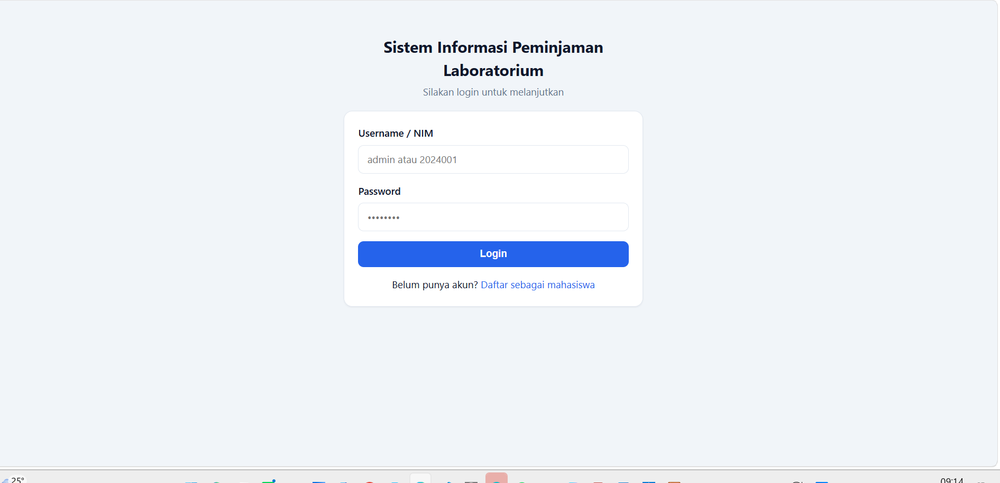
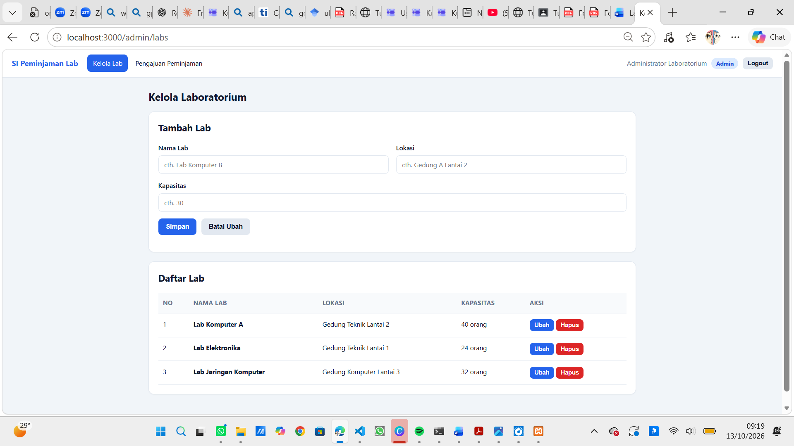
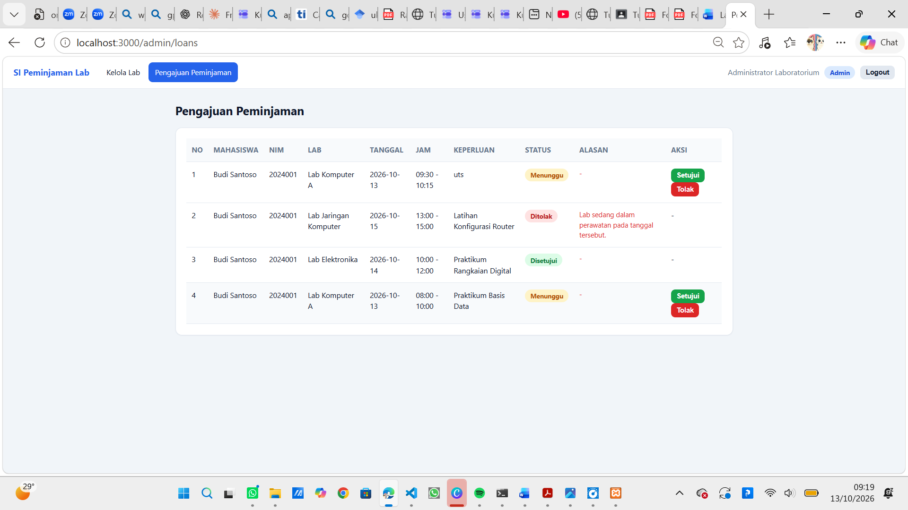
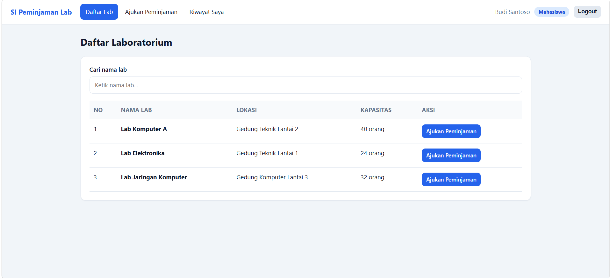
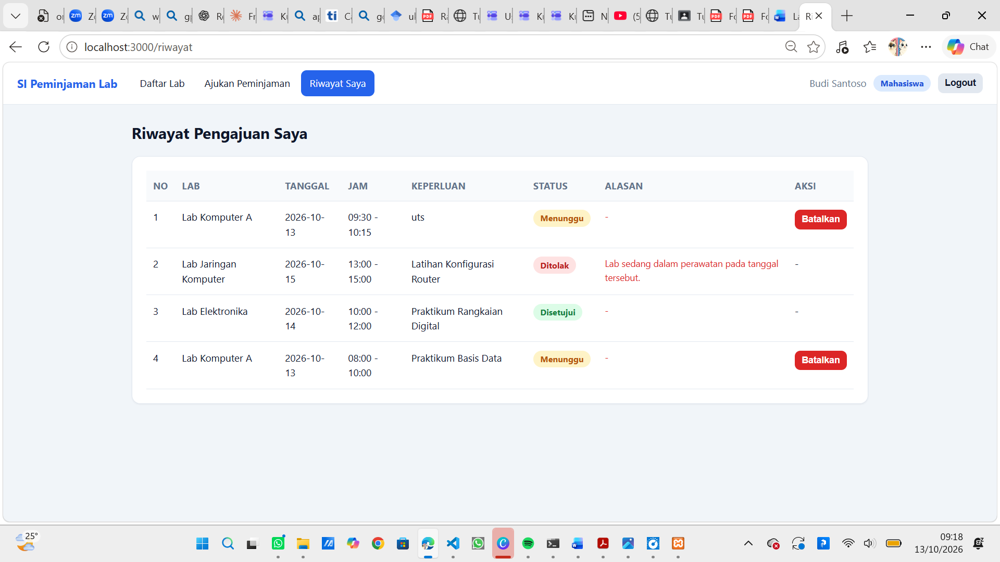

# Sistem Informasi Peminjaman Laboratorium

Aplikasi web sederhana untuk pengelolaan peminjaman laboratorium kampus.
Mahasiswa dapat melihat daftar lab dan mengajukan peminjaman, sedangkan admin
dapat mengelola data lab serta menyetujui atau menolak pengajuan.

## Teknologi

- **Backend:** Node.js dengan Express
- **Database:** file JSON di folder `database/` (satu file per entity:
  `users.json`, `labs.json`, `loans.json`) — tanpa database lain
- **Frontend:** HTML, CSS, JavaScript murni di folder `public/`
- **Library:** `express`, `express-session`, `bcryptjs` (pure JavaScript,
  tanpa kompilasi native)

## Fitur

1. Login dan logout (sesi dengan `express-session`).
2. Registrasi akun mahasiswa (nama, NIM, password).
3. Admin: tambah, lihat, ubah, hapus data lab (nama, lokasi, kapasitas).
4. Mahasiswa: melihat daftar lab dengan kolom pencarian nama lab.
5. Mahasiswa: mengajukan peminjaman (lab, tanggal, jam mulai, jam selesai, keperluan).
6. Sistem menolak otomatis pengajuan yang **bentrok dengan peminjaman yang sudah
   disetujui** di lab & tanggal sama, atau bila **jam selesai lebih awal dari jam mulai**.
7. Admin: melihat semua pengajuan, menyetujui atau menolak (penolakan wajib
   mengisi alasan).
8. Mahasiswa: melihat riwayat pengajuan beserta status
   (menunggu, disetujui, ditolak, dibatalkan) dan alasan penolakan.
9. Mahasiswa: membatalkan pengajuan yang masih berstatus menunggu.

### Non-fungsi

- Password disimpan sebagai **hash** (`bcryptjs`), tidak pernah polos.
- Halaman dan API dilindungi sesi + peran (mahasiswa tidak bisa membuka fitur admin).
- Validasi input di server dengan pesan error yang jelas.
- Tampilan bersih, responsif, dengan navbar, tabel, form, dan badge warna status.

## Tampilan Aplikasi

### Login



### Admin





### Mahasiswa





## Akun Contoh

| Peran     | Identitas | Password  |
| --------- | --------- | --------- |
| Admin     | `admin`   | `admin123` |
| Mahasiswa | `2024001` | `mhs123`  |

Data awal (seed) juga berisi 3 lab contoh dan 3 pengajuan contoh dengan status
berbeda (menunggu, disetujui, ditolak). Seed dibuat otomatis saat file database
masih kosong.

## Struktur Folder

```
.
├── database/            # Database file JSON (dibuat otomatis saat pertama jalan)
│   ├── users.json
│   ├── labs.json
│   └── loans.json
├── lib/
│   ├── db.js            # Helper baca/tulis file JSON
│   └── seed.js          # Data awal (seed)
├── middleware/
│   └── auth.js          # Proteksi sesi & peran
├── routes/
│   ├── auth.js          # API registrasi/login/logout
│   ├── labs.js          # API lab (CRUD admin)
│   └── loans.js         # API peminjaman (ajukan, riwayat, batal, approve/reject)
├── public/              # Frontend HTML, CSS, JS
│   ├── css/style.css
│   ├── js/*.js
│   ├── index.html       # Login
│   ├── register.html    # Registrasi mahasiswa
│   ├── labs.html        # Daftar lab (mahasiswa)
│   ├── ajukan.html      # Form pengajuan (mahasiswa)
│   ├── riwayat.html     # Riwayat pengajuan (mahasiswa)
│   ├── admin-labs.html  # Kelola lab (admin)
│   └── admin-loans.html # Pengajuan & persetujuan (admin)
├── screenshots/         # Tangkapan layar aplikasi (Login, Admin, Mahasiswa)
├── server.js            # Entry point Express
├── package.json
└── README.md
```

## Cara Menjalankan

```bash
npm install
npm start
```

Buka **http://localhost:3000** lalu login dengan akun contoh di atas.

> Port bisa diubah dengan environment variable, misalnya `PORT=4000 npm start`.
